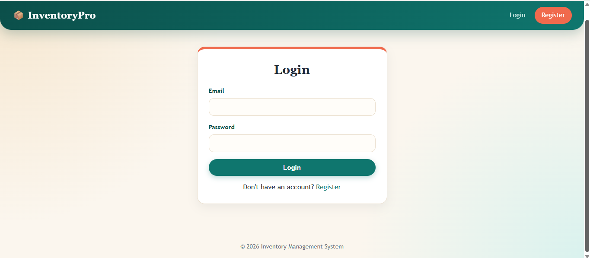
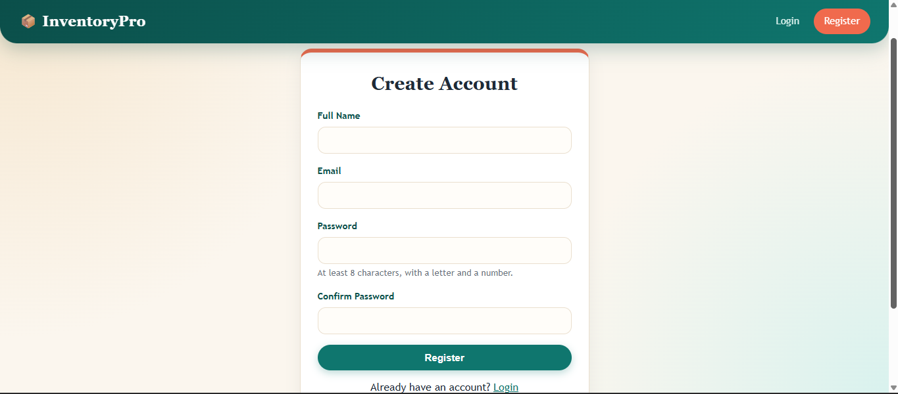
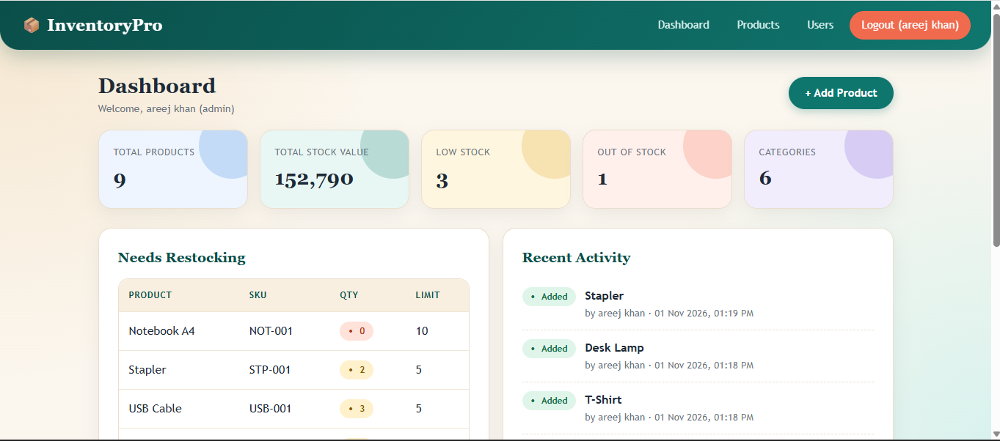
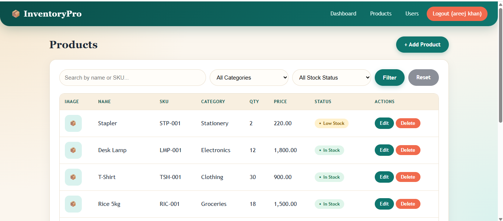
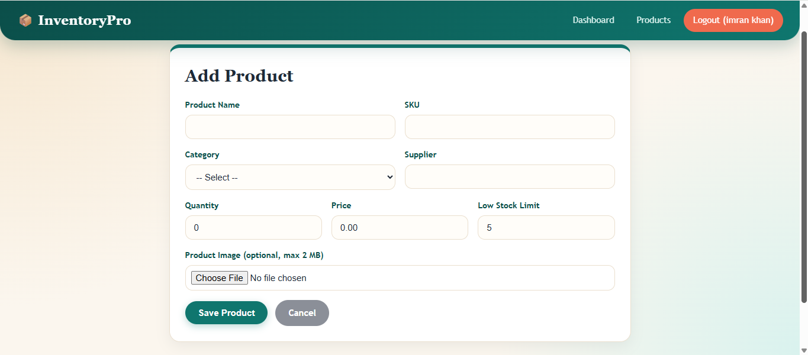
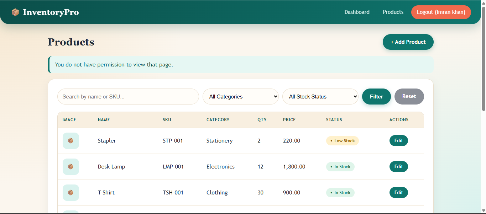

# 📦 InventoryPro – Inventory Management System

A full-stack inventory management web application built for **Devixo Solutions – Web Development Internship (Task 04)**.

## Features
- **Authentication:** register, login, logout, password validation, protected pages
- **Product management (CRUD):** add, view, edit and delete products, with optional image upload
- **Dashboard:** stat cards (total products, stock value, low stock, out of stock, categories), a "Needs Restocking" list and a recent activity log
- **Search, filters and pagination:** search by name or SKU, filter by category and stock status
- **Role-based access:** the first registered user becomes **Admin**, everyone after that is **Staff**. Only admins can delete products and manage users
- **Admin panel:** view all users, change roles, delete users
- **Responsive UI:** mobile-friendly layout with a collapsible menu

## Security
- Passwords hashed with `password_hash()` and checked with `password_verify()`
- Prepared statements (PDO) to prevent SQL injection
- Output escaped with `htmlspecialchars()` to prevent XSS
- Session ID regenerated on login
- Server-side input validation and role checks
- Image uploads validated by real MIME type, limited to 2 MB, and saved under random file names

## Tech Stack
- **Frontend:** HTML5, CSS3, JavaScript
- **Backend:** PHP 8
- **Database:** MySQL (MariaDB)
- **Server:** Apache (XAMPP)

## Project Structure
```
inventory-system/
├── admin/          (users.php)
├── assets/         (css, js, uploads)
├── auth/           (login, register, logout)
├── config/         (db.php)
├── includes/       (header, footer, auth_check)
├── products/       (list, add, edit, delete)
├── screenshots/
├── dashboard.php
├── index.php
└── database.sql
```

## How to Run Locally
1. Install [XAMPP](https://www.apachefriends.org/) and start **Apache** and **MySQL**.
2. Copy the project folder into `xampp/htdocs/inventory-system`.
3. Open `http://localhost/phpmyadmin`, go to the **Import** tab and import `database.sql`.
4. Open `http://localhost/inventory-system/` in your browser.
5. Register an account. The first account becomes the admin.

## Screenshots

| Login | Register |
|---|---|
|  |  |

| Dashboard | Products (Admin) |
|---|---|
|  |  |

| Add Product | Users (Admin only) |
|---|---|
|  |  |

| Staff access restriction |
|---|
|  |

## Author
**Areej Khan** – Web Development Intern at Devixo Solutions